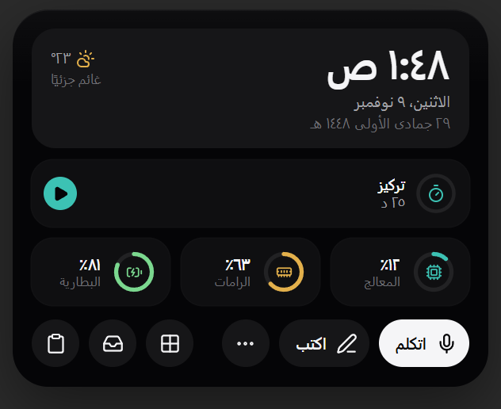
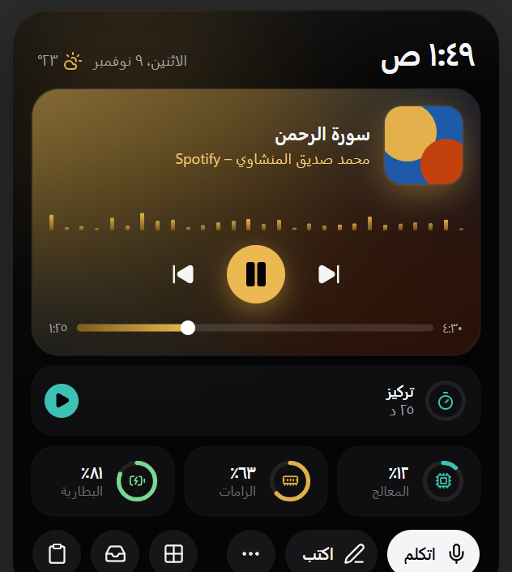
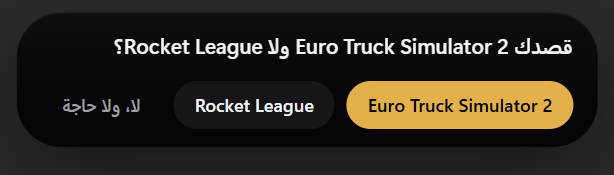
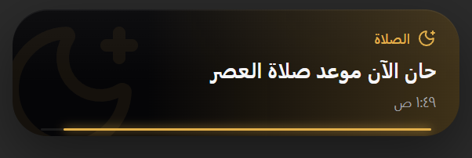

<div align="center">


# يوبي · Yobi

**مساعد صوتي بالمصري للويندوز.** بتكلّمه فيفتح برامجك وألعابك ومواقعك، يتحكم في جهازك، ويرد عليك بصوته.

*An Egyptian Arabic voice assistant for Windows.*

[](https://github.com/abohamada15423/yobi/releases/latest/download/Yobi-Setup.zip)


[](https://github.com/abohamada15423/yobi/releases/latest)

<br>



</div>

---

## يعمل إيه

| | |
|---|---|
| 🎙️ **بتكلّمه عادي** | «يا يوبي افتح ديسكورد»، «علّي الصوت»، «شغّل يوتيوب». بيفهم المصري ولو الكلمة اتنطقت غلط. |
| 🎮 **يعرف جهازك** | بيلاقي البرامج والألعاب (Steam وغيره) والمواقع اللي في المتصفح لوحده من أول تشغيل. |
| 🏝️ **جزيرة فوق الشاشة** | شريط صغير بيوريك الساعة والطقس والأغنية الشغالة والتحميلات، ويكبر لما تحتاجه. |
| 🕌 **الصلاة والأذكار** | مواعيد الصلاة لمدينتك، تنبيه قبل الأذان، أذكار وآيات خفيفة طول اليوم. |
| ⏱️ **تركيز واجتماعات** | مؤقّت تركيز، وتنبيه قبل اجتماعاتك من Google Calendar أو Outlook. |
| 👁️ **بيشوف الشاشة** | اسأله «إيه اللي على الشاشة؟» أو علّمه مهمة يعيدها بعدين (محتاج مفتاح Gemini). |
| 🔌 **من غير نت** | من غير مفتاح ولا إنترنت بينفّذ الأوامر الأساسية بموديل صغير على جهازك. |

<div align="center">

&nbsp;

<br>

</div>

---

## التثبيت

1. نزّل **[Yobi-Setup.zip](https://github.com/abohamada15423/yobi/releases/latest/download/Yobi-Setup.zip)** (حوالي 270 MB).
2. فك الضغط، ودوس مرتين على **`Install Yobi.cmd`**. مش محتاج صلاحيات أدمن.
3. أول مرة هيطلب **مفتاح Gemini المجاني** — الخطوات مكتوبة في `README.txt` جوه الملف. أو دوس «كمّل من غير مفتاح» للأوامر بس.

> [!NOTE]
> ويندوز ممكن يطلّع تحذير SmartScreen عشان البرنامج مش موقّع. دوس **More info** وبعدين **Run anyway**.

## إزاي تكلّمه

- قول **«يا يوبي»** وبعدها الأمر، أو دوس **`Ctrl + Alt + Y`** وكلّمه.
- عايز زرار تاني؟ الإعدادات ← **الاختصار والشاشة** ← **زرار النداء**، ودوس أي زرار تختاره (مثلاً `F8`).
- النداء بالصوت متدرّب على صوت واحد، فلو مش بيسمعك كويس خلّيه بالزرار بس من نفس المكان.

## المتطلبات

- Windows 10 أو 11 (64-bit) ومايك.
- حوالي 700 MB مساحة.
- مفتاح [Gemini](https://aistudio.google.com/apikey) مجاني للدردشة وشوف الشاشة (اختياري).

## إزالة يوبي

من **Settings ← Apps** دوّر على Yobi ودوس Uninstall. بياناتك بتتمسح معاه.

---

<details>
<summary><b>للمطورين</b></summary>

<br>

```bash
pip install -r requirements.txt
copy config.example.json config.json
copy .env.example .env
python agent.py
```

الجزيرة (Tauri) محتاجة Node و Rust:

```bash
cd island-tauri
npm install
npx tauri build
```

| الفولدر | فيه إيه |
|---|---|
| `*.py` | يوبي نفسه: `agent.py` البداية، `brain.py` و `local_brain.py` الفهم، `audio_input.py` و `stt_engine.py` و `tts_engine.py` الصوت |
| `island-tauri/` | الجزيرة والإعدادات (React + Tauri) |
| `packaging/` | بناء `Yobi-Setup.zip` والتثبيت |
| `tests/` | الاختبارات: `python tests/test_<name>.py` |
| `tools/` | سكريبتات تدريب وقياس |

بناء ملف التثبيت: `python packaging/build.py` (بعد بناء الجزيرة).

</details>
